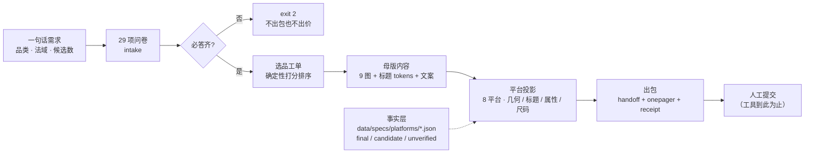

# crossborder-delivery-skill

**给「品类 + 目标法域 + 候选数」，产出一份能被人直接接手提交的上品包；每一段都留下可回放的台账。**


覆盖俄罗斯 / 东南亚 / 海湾共 9 个法域、8 个平台（Ozon、Яндекс Маркет、Wildberries、Shopee、Lazada、TikTok Shop、Amazon、noon）。

不做自动上架：不调用上架 API、不保存商户凭证、不自动提交、不自动花钱。产出停在「材料齐备、等人接手」这一步。

---

## 它反对什么

跨境工具的通病是**给你一个结果，但不告诉你依据**。listing 被拒时你不知道是哪条规则、哪个数字、谁在什么时候改的。

这个仓库把每一条都变成可核对象：

| 普通工具 | 这里 |
|---|---|
| 「标题最多 60 字符」 | `platform.wildberries.title.max_chars = 60`，带 `source_url`、抓取时间、`final/candidate` 等级、官方原文摘录 |
| 「图片裁成 1:1」 | 记录算法版本 `contain-pad-white-v1`、内容区坐标 `[112,0,675,900]`、输出画布 `[900,900]`；**不裁掉任何像素** |
| 「预估毛利 35%」 | 每个数字带口径与来源；缺一项就 `unavailable` 并点名缺哪项，不编 |
| 「已通过校验」 | 说清楚是 L0 静态检查 / L1 本地跑通 / L2 平台侧实证 |

## 30 秒上手

不需要任何 key、不需要联网、不需要外部服务：

```bash
npm ci              # 只有两个依赖：ajv、sharp
npm run quickstart  # 内置样例工单 + 占位图 + 桩判别，约 10 秒
```

跑完打开它打印的 `handoff.md`。你会看到一份**带 4 项阻断的降级包**——这是刻意的：样例没填问卷、没品牌授权、没认证。工具不会假装它能上架。

想看「填完问卷之后」的样子：

```bash
npm run intake -- --list                                  # 29 项必问清单（必答 16 / 需确认 9 / 可默认 2）
node scripts/intake.mjs --check --answers answers.json    # 先校验，缺必答项 exit 2 并点名
node scripts/chain.mjs --category 女装 --region RU --candidates 1 --intake answers.json
```

## 装进你自己的 Agent

这是一个标准 Skill 目录（`SKILL.md` + `scripts/` + `core/` + `data/`），三种用法：

```bash
# 1) 直接放进技能目录（WorkBuddy / Claude Code 通用）
cp -r . ~/.workbuddy/skills/crossborder-chain     # 或 ~/.claude/skills/
# 2) 只当命令行工具用
npm ci && npm run quickstart
# 3) 当库引用
import {computePricing} from "./scripts/lib/chain-stages.mjs";
```

技能识别靠 `SKILL.md` 的 frontmatter（name / description / version），不需要改配置。

## 产出长什么样

```
package/<sku>__<时间片>/
├── handoff.md              # 给人看的交付说明（阻断项置顶 / 市场底数 / 开工三步 / 文件地图）
├── onepager.html           # 一页商品卡，数据全来自包内，可直接投屏
├── receipt.json            # 给机器看的回执（每段决定 + 依据）
├── master/                 # 母版：9 图 + 标题 tokens + 文案源
│   ├── images/img-01..09
│   ├── title.tokens.json
│   └── manifest.json       # 每图 sha256，投影时校验
└── platforms/<平台>/        # 平台投影，一平台一目录
    ├── images/             # 按该平台规格产出
    ├── crop.json           # 几何变换台账
    ├── size-mapping.json   # 尺码映射（含未核字段清单）
    ├── title.txt           # 通过 lint 才写；不通过只给 candidate 稿
    ├── copy/               # 逐条可粘贴的文案
    └── validate.json       # 通过项 / 违规项 / 未核事实
```

`handoff.md` 的开头长这样——**阻断项必须在第一屏**：

```text
BLOCKED: 本包暂不可直接上架（4 项待解）
  1. 待完成：准入完成后，须由目的国进口商申请一物一码 DataMatrix……
     怎么解：找代运营/服务商办诚信标签（Честный знак），办完再上这一批
  2. 待完成：EAC 证书主体、诚信标签申请主体与进口报关主体必须一致。
  3. 品牌授权未证（brand_unknown）：不得上架品牌款
  4. 上架信息未收齐（--intake 缺失）：价格未出，不得声称可上架
```

## 一条命令：方向 → 可提交包

```bash
npm run chain:dir -- --direction "女士针织开衫" --region RU
```

跑完会告诉你四件事：方向成不成立、候选有哪几条、真实报价能不能覆盖目标进价、包出在哪；外加**上架还差哪几项**（分成「阻断出包」与「只挡上架」两列，不混在一起）。

clone 下来想直接看产出，用仓库里那份标注过的演示答卷（每项都写了 `measured / estimated / demo`）：

```bash
npm run chain:dir -- --direction "女士针织开衫" --region RU --intake data/intake/demo-ru.json
# → package/<sku>/handoff.md（已存在则加 __<时间片>）
# 耗时 30 秒到 5 分钟：干净 clone 首次约 36 秒；本机有历史产物时会重新出图建模，约 4–5 分钟
```

下面是这条命令内部依次跑的五段，也可以单独调。

前三段不需要你手里有货，也不需要填问卷。**顺序不能反**——先验证市场，再谈货源。

| 段 | 命令 | 你得到什么 | 当前证据等级 |
|---|---|---|---|
| ① 方向验证 | `npm run market:scan -- --direction "女士针织开衫" --region RU` | 品类码、进口规模、季节窗口、**款级搜索指数与购物车均价**、方向成立与否 | **L2**（数据实抓） |
| ② 选品决策 | `npm run select:candidates -- --direction "..." --region RU --count 8` | 5–10 个候选，每个带证据等级、敏感性、自我查证 | **L0**：候选是按约束枚举的，不是从竞品销量推出来的 |
| ③ 反查货源 | `npm run source:lookup -- --direction "..." --region RU --pick c01` | 1688 检索词、规格要求、**目标进价上限**、验货要点、**真实报价与实算毛利** | **L2**：55 条实测报价（见下行） |
| ③-a 抓报价 | `npm run quotes:1688 -- --keyword "针织开衫" --target-price 71.6` | 真实报价分布 + 「目标价以内有几家」 | **L2**：1688 搜索页实测，需 922 上的已登录 Chrome |
| ④ 出包 | `npm run chain -- --category 女装 --region RU --candidates 1 --intake answers.json` | 母版图、平台投影、尺码映射、handoff | **L1**：结构完整，图为占位 |
| ⑤ 上架 | `npm run probe:account` 之后接 `/v3/product/import` 流程 | 商品在平台上创建、有库存、可售 | **L2**：真实跑通并回读确认 |

一段真实的数字链条（俄罗斯女装开衫）：

```
平台购物车均价 175.36 CNY（搜索 394,600/月，供需比 10，加购率 16.06%）
  → 候选定价 180 CNY（2180 RUB）
    → 目标进价 ≤ 71.6 CNY（扣佣金 18%、履约 22 元、毛利 30% 后倒推）
      → 1688 实测 55 条报价：P25 29.7 / 中位 39.0 / P75 58.5
        → 目标价以内 46 家（83.6%）→ 能拿到货
          → 按中位进价实算毛利 48.1%（不是设定的 30%）
```

**每一环都能反算，而且进出都有实测**：`marginAt({priceCny: 180, costCny: 39})` 返回 48.1；报价 55 条是抓下来的，不是估的。

**已知边界照实写**：报价是 1688 列表页的**起批价**，不含国内段运费、不含税、未含议价；关键词是泛词时，溢价款（羊毛混纺 / 高含毛）实际报价更高，脚本会单独告警。② 的候选仍是「按约束枚举」——排序依据是依据强度，不是竞品销量。

② 的候选不是「市场验证过的爆款」，是「按约束枚举出的合理选项」，排序依据是依据强度而非销量预测。③ 给的是谈判上限，不是成交价。

## 四条设计原则

**1. 事实分级，不混用。** 每条平台规则标记 `final`（官方原文）/ `candidate`（二手或多源未核）/ `unverified`。判定只看关键事实的等级，不看「有没有任意一条 final」——这曾经让一个文档被封的平台被误判成可提交。

**2. 缺事实就抛错，不猜。** 没有图片比例事实时抛 `FACTS_INCOMPLETE`，而不是拿一个「行业惯例」顶上。宁可退化，不可编造。

**3. 不裁图。** 1:1 平台（Shopee / Lazada / TikTok Shop）对 3:4 母版做**等比缩放 + 白底补方**，不中心裁切。中心裁切会切掉上下各 12.5%，裙摆和领口正好在那两条带上。

**4. 阻断可见。** 缺认证、缺品牌授权、缺问卷答案，一律写在 `handoff.md` 第一屏并给出解法，不埋在附录。

## 覆盖范围

| 平台 | 法域 | 事实（final / candidate） | 判定 |
|---|---|---|---|
| Ozon | RU | 9 / 1 | 可出包 |
| Яндекс Маркет | RU | 13 / 0 | 可出包（平台未规定比例，原图直出） |
| Wildberries | RU | 19 / 1 | 可出包 |
| Shopee | SG MY TH PH ID VN | 13 / 1 | 可出包 |
| Lazada | SG MY TH PH ID VN | 9 / 5 | 可出包（1:1 为多源口径，补边不裁；尺寸下限待后台确认） |
| TikTok Shop | SG MY TH PH ID VN | 6 / 0 | 可出包 |
| Amazon | AE SA SG | 19 / 2 | 可出包（官方不规定比例，原图直出） |
| noon | AE SA | 26 / 1 | 可出包 |

九个法域全部至少有一个可出包平台。实时状态用 `npm run platform:readiness` 重新生成，不要手改表。

**平台规则的来源**：官方开放平台文档、卖家帮助中心（含中文站）、`llms.txt`、Wayback 存档、搜索引擎索引到的官方页。每条事实都带 `source_url` 与抓取时间；被墙或需登录的会写明「试过什么、为什么不通」，而不是留空。

## 命令

| 命令 | 作用 |
|---|---|
| `npm run quickstart` | 零 key 跑通全链路，产出演示包 |
| `npm run intake -- --list` | 29 项必问清单（唯一真源：`core/intake/checklist.mjs`） |
| `npm run chain -- --category 女装 --region RU --candidates 2` | 真实链路 |
| `npm run title:check -- --platform noon --text "..."` | 按平台规则检查标题 |
| `npm run platform:readiness` | 重新生成 8 平台 × 9 法域就绪矩阵 |
| `npm run region:data` | 世界银行宏观底数（免 key） |
| `npm run holidays:probe` | 九国公共假日（Google 官方日历 + Nager 交叉核对） |
| `npm run trade:probe -- --hs 6204` | 品类进口规模与单价（UN Comtrade） |
| `npm run probe:account -- --platform ozon --env <路径>` | 探测账号能读什么、能不能写（三态判定） |
| `npm run mcp` | 以 MCP server（stdio）暴露给任意客户端 |

退出码：`0` 完成（含降级）｜`2` 输入或前置不成立｜`3` 有候选失败｜`4` 机械门未过。

## 架构



| 层 | 路径 | 职责 |
|---|---|---|
| 入口 | `scripts/chain.mjs` | 自检 → 工单 → 排序 → 判别 → 出图 → 建模 → 出包 |
| 定价 | `scripts/lib/chain-stages.mjs` | 纯函数，不碰 IO |
| 出包 | `scripts/lib/package-runner.mjs` | 母版 + 平台投影 + handoff |
| 平台投影 | `adapters/platforms/project.mjs` | 几何变换、标题、属性、校验 |
| 事实层 | `data/specs/platforms/<p>.json` | 每条规则带来源、等级、抓取时间 |
| 法域层 | `regions/<CC>/` | 尺码体系、税费参考、合规规则、节假日 |
| 契约 | `schemas/` | JSON Schema，产出必须过校验 |

## 质量门

```bash
npm test               # 361 项，零网络零 key
npm run check:decouple # 7 道机械门（改完 core/ 或 data/specs/ 必须单独跑，test 不含它）
npm run evals          # 产出正确性（毛利口径、尺码映射、缺项点名）
npm run selfgrade      # 自评
```

七道门包括：`core/` 里不得出现平台名字面量（防止把业务规则写死）、事实必须带来源、问卷不得有绝对路径、配置不得越过 schema 等。

## 不做什么

- **不绕过反爬**：robots 明确 `Disallow` 的站不抓（例如 Tokopedia）。
- **不把估算当实测**：缺失一律标 `unavailable` + 原因；估算必须 `source=estimated` + 依据 + 置信度。
- **不替卖家做商业决定**：定价给区间与敏感性，不给「唯一最优」。
- **不碰店铺操作**：不代发消息、不代改价、不代提交。

## 文档

- [`docs/信息需求清单.md`](docs/信息需求清单.md) — **29 项问卷逐项写清「从哪拿」**：谁去办、抄什么、查不到怎么办（`npm run intake:render` 生成）
- [`docs/交接.md`](docs/交接.md) — 接手者先读这个：三条命令、代码地图、哪里不能动
- [`docs/平台就绪矩阵.md`](docs/平台就绪矩阵.md) — 8 平台 × 9 法域，谁缺什么
- [`docs/信息源盘点.md`](docs/信息源盘点.md) — 七类通道的实测可用率
- [`docs/未决问题清账.md`](docs/未决问题清账.md) — 每个攻不下的目标试过什么、为什么不通

## License

MIT，见 [LICENSE](LICENSE)。
